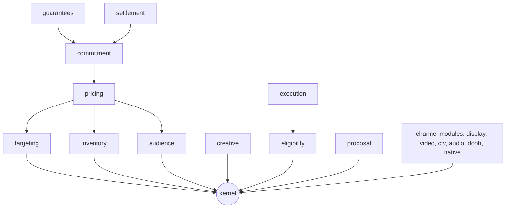

# OpenProposal 3.0 schema: design proposal

The first plan for a JSON Schema of OpenProposal 3.0 draft 1, written before the method the README describes. It arranges the schema as layers, modules, and extensions. The extension parts stay a proposal for the working group (see [Extension points](#extension-points-proposed-not-in-the-specification)).

## What we build, and why it beats an opinion

The repository's [schema README](https://github.com/IABTechLab/OpenProposal/blob/44dfaaf618736219426c311ec997b6d37e94b950/schema/README.md) holds the schema back, so that three questions stay open: OQ-1 (mutability in the object), OQ-2 (`catalog_ref`), and OQ-7 (`environments`). It asks anyone who builds a schema to report "what you had to decide in order to write it". The plan delivers three things:

1. **Draft-1 schema, as written.** Every field in Appendix A, with its marker, validates the four example files. Every place the prose didn't decide is logged as a forced decision. This becomes the implementation feedback issue.
2. **The modular schema.** The same model, arranged as a kernel, modules, channel modules, and extensions. This is what the revision can adopt. It answers OQ-1, OQ-2, and OQ-7 structurally, not by opinion.
3. **Reference tools.** A two-pass validator, the price resolver (#30 and PR #117), the agreed-record digest (#63), and a daypart evaluator. Each one tests our own proposals; for example, the resolver would have caught the #94 `derived_units` formula error.

## Layers

Each layer depends only on the layers below it. Modules name each other only by kernel ID types, never by `$ref`.

The kernel holds:

- IDs: `proposal_id`, `line_item_id`, `seller_id`, and option IDs;
- values: money, ISO 4217 currency, timestamps, ISO 8601 durations, civil-time windows, and IANA time zones;
- the mutability wrappers;
- `catalog_ref`;
- the open-union markers;
- the canonicalization rule that the record digest uses.

The extension entry `{ uri, digest, data }` and the extension-point markers are our proposal, not part of the generated kernel (see [Extension points](#extension-points-proposed-not-in-the-specification)).

The proposal module holds § 4: identity, lifecycle, assent, and negotiation history. Line-item modules map one-to-one to § 5.2 through § 5.10. Arrows show `$ref` direction. The commitment module, for example, references pricing because `derived_units` reads the committed price entry.

## Mutability as a schema mechanism (OQ-1)

Markers become an annotation, `x-op-mutability`, on each property. Plus there are two generic wrappers, expanded per field at build time:

- `Selectable<T>` is `{ available[]: T, included[], pricing?, max_select? }`, with the § 3.1 fallback: a bare `T` means `seller-set`.
- `Settable<T>` is `{ allowed[]: T } | { min, max }`, plus `value` and `default` (from #22 and our #58 reply), with the § 3.2 fallback.

The build expands the wrappers into concrete schemas, so validators and code generators see plain JSON Schema. The forced-decision log records what the prose didn't settle, such as whether `included[]` must be a subset of `available[]` (§ 3.1 implies it but never says so), or whether `pricing` keys must be option IDs.

## `catalog_ref` (OQ-2)

`CatalogRefOr<T>` is `oneOf` an inline `T` and `{ catalog_ref }`. Only fields the seller declares as catalog-backed get the wrapper, not every field. A profile, `agreed`, forbids the reference form. That makes "an agreed record is self-contained" a schema check, not prose.

## Channels and vocabularies (OQ-7)

`channel` is an open union. Core branches are `display`, `video`, `ctv`, `audio`, `dooh`, and `native`, with each branch's channel module carrying its keys: `placement` for video and CTV, `feed` for audio, and screens and loop for DOOH. Under our extension proposal, a new channel, such as `print` (#102) or static `ooh` (#49), would be a branch ID `<uri>#<branch>` whose body is an extension entry, and it would need no core release. The § 5.1 rule "a consumer MUST skip a line item whose `channel` it does not recognize" would be the must-understand policy `flag` at that point.

Vocabularies (`environments`, `cost_method`, measurement provider, and `transaction_mechanism`) follow our #94 design: core terms plus `<domain>:<term>` extensions. Under our extension proposal, a term that carries parameters would point to an extension entry for its body.

## Extension points: proposed, not in the specification

This section is our proposal for the working group, not generated schema. The specification states no extension point, envelope, or manifest, so the model has none and the emitter publishes none. They become generated schema only when the specification states them ([type rules § 12](type-rules.md#12-proposed-not-in-the-specification)).

| Host | Policy | Why |
|---|---|---|
| `commitment` and agreed terms | `always` | Binding. The record digest covers it |
| `pricing[]` entry | `flag` | A receiver can skip an unknown price entry unless the entry says it must be understood |
| `channel` union | `flag` | Matches § 5.1's skip rule |
| `specifications`, `content_detail` | `never` | Descriptive only |
| `external_references[]` | `never` | Readback |

The proposal would carry `extensions[]`, a manifest of `{ uri, digest }`, so a buyer agent knows before parsing whether it can commit.

## Representations

The summary representation (§ 2.1) is a generated profile, a projection of the full schema. It isn't a second hand-written schema. Three profiles come out of one source: `summary`, `full`, and `agreed`.

## Tools

- **Language:** Python 3.12. It matches the repository's `scripts/` and CI.
- **Validation:** JSON Schema 2020-12.
- **Digest:** RFC 8785 JSON Canonicalization Scheme (JCS) with SHA-256.
- **Checks:** a cross-check against Appendix A, so the schema and the spec can't drift. It reuses the parsing in `scripts/check_appendix.py`.
